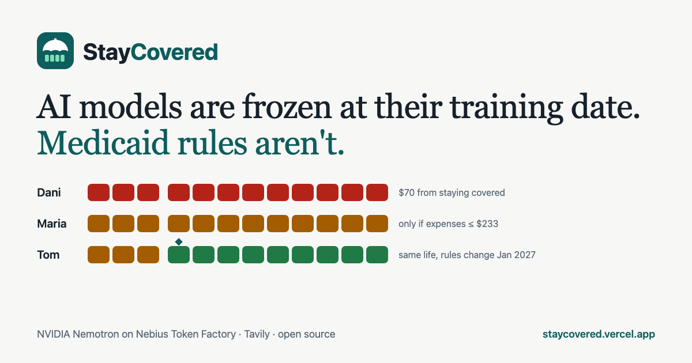
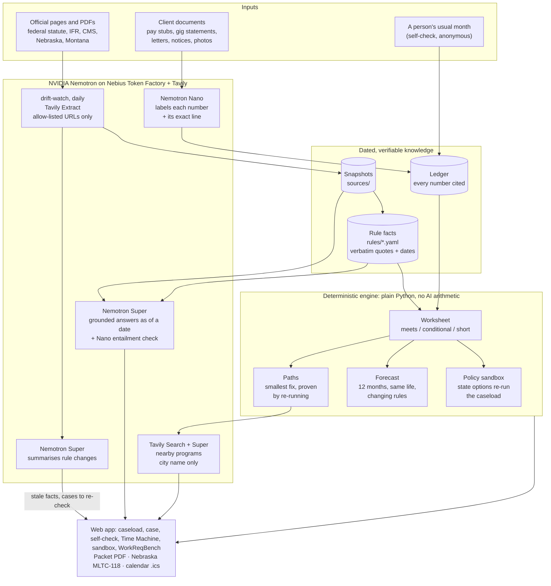

<p align="center"></p>

<h1 align="center">StayCovered</h1>

<p align="center"><b>AI models are frozen at their training date. Medicaid rules aren't.</b></p>

StayCovered is an open-source copilot that helps people keep Medicaid under the new community engagement ("work") requirements. Navigators get a case worksheet in which every number and rule is cited; people without a navigator get a bilingual self-check. Every answer is grounded in the official rules *as of a specific date*, open cases are re-checked when those rules change, and the engine finds the smallest proven fix when someone falls short. Nebraska and Montana today.

Built for the Nebius × NVIDIA Global AI Hackathon 2026 (Best Apps and Agents). Inference uses NVIDIA Nemotron on Nebius Token Factory; official-source monitoring and local-program search use Tavily.



## Links

| What | Link |
|---|---|
| **Live app** (start with the ▶ Tour button) | https://staycovered.vercel.app |
| **Demo video** (2:54) | https://youtu.be/yU-Pz7eQGcs |
| Self-check for people without a navigator (English/Spanish) | https://staycovered.vercel.app/check |
| Policy sandbox: flip state choices, watch the caseload change | https://staycovered.vercel.app/sandbox |
| Rule Time Machine: rules and answers as of any date | https://staycovered.vercel.app/time-machine |
| **Watch the agent handle a (synthetic) notice** (one click, a recorded run, about 10 s) | https://staycovered.vercel.app/cases/maria-lopez?run=1 |
| Example case: Dani, $70 from staying covered (paths + nearby programs) | https://staycovered.vercel.app/cases/dani-ortiz |
| Example case: Tom, same life, changing rules (forecast) | https://staycovered.vercel.app/cases/tom-becker |
| WorkReqBench results | https://staycovered.vercel.app/bench |
| WorkReqBench method, judge and limitations | [bench/README.md](bench/README.md) |
| Under the hood: model routing, costs, every Tavily request | https://staycovered.vercel.app/under-the-hood |
| Source code | https://github.com/TusharTechs/staycovered |
| Evidence for the problem | [docs/EVIDENCE.md](docs/EVIDENCE.md) |
| Feedback on Nebius Token Factory and Tavily | [FEEDBACK.md](FEEDBACK.md) |

## Results (WorkReqBench, held-out)

86 dated questions that were never inspected while building or tuning:

| System | Score (95% CI) | Questions whose answer changed over time |
|---|---|---|
| **StayCovered**: Nemotron Super + official rules as of the date | **72.9%** (65.7–79.5) | **66.7%** |
| Nemotron Super + today's sources (date-blind) | 65.5% | 48.5% |
| Claude Opus 5.5 answering from memory | 63.0% (55.6–70.2) | 44.6% |
| Nemotron Super answering from memory | 35.3% | 27.0% |

Paired comparison on the same questions:

| StayCovered compared with | Overall gap (95% CI) | Date-sensitive gap (95% CI) |
|---|---|---|
| Claude Opus 5.5 | **+9.9 points** (+1.0 to +18.4) | **+22.1 points** (+8.3 to +36.3) |

How to read this:
- On federal questions the two systems are roughly tied (71% vs 70%). The advantage comes from Nebraska rules (75% vs 54%) and rules that changed over time.
- The ranking is the same under three graders: Nemotron Ultra, Nemotron Super and Claude Haiku. Details are in `bench/` and on the WorkReqBench page.

> StayCovered organises evidence against published rules. It does **not** decide eligibility or exemptions; the state agency does. All demo cases are synthetic.

## Why

- Under H.R.1, every Medicaid expansion state must verify work or community engagement from **January 1, 2027**.
- Nebraska started early, in May 2026. In its first months, most coverage losses at renewal were people not responding to information requests, rather than people found non-compliant (see [docs/EVIDENCE.md](docs/EVIDENCE.md)).
- The rules are still moving:
  - an interim final rule (June 2026)
  - a correction (June 29)
  - CMS frailty guidance (Sept 8)
  - state process changes
- A model trained before those dates gives confidently stale answers.

## What it does

| Feature | What it means |
|---|---|
| **The StayCovered agent (start here)** | One click runs a case end to end as 10 visible steps: read the state's notice (Nemotron Nano) → explain it in the client's language (Nano) → read the client's documents (Nano, checked against the reviewed ledger) → apply the rules as of the date (code) → find the smallest proven fix (code) → forecast 12 months (code) → find nearby programs (Tavily Search + Super) → check the key rule against official text (Super + Nano) → draft a message for the client (Super, every number checked against the worksheet) → assemble the packet, state form and reminders. Each step shows its model, tokens, cost and time. The receipt prices the same tokens three ways: a whole case costs $0.003–0.007 on right-sized Nemotron, about 4× less than running every step on Nemotron Ultra and 16–27× less than a frontier model's list price ($4/$20 per million tokens, an assumed price). On the public site the agent replays recorded runs (each step is labelled "recorded run"); run it locally with `?live=1` to watch every call happen live. Try it: [Maria's case](https://staycovered.vercel.app/cases/maria-lopez?run=1). |
| **Attestation worksheet** | Messy client documents become a month-by-month worksheet against the 80-hour / $580 test. Inputs include gig-app weekly statements, pay stubs and volunteer letters. **Code does all arithmetic.** Every number links to the exact line in the client's document. Household MAGI income, the income-to-hours conversion, seasonal six-month averaging and weeks that cross months are handled explicitly. Gig payouts before expenses produce *"meets if expenses are ≤ $X"* instead of a false "meets". |
| **Grounded answers, as of a date** | Nemotron Super answers from the rule facts and official passages that existed on the chosen date. Citations are checked verbatim against the captured source, and a second, cheap check (Nemotron Nano) confirms each quote actually supports the answer. Anything unsupported becomes "can't confirm — check with the agency". |
| **Rule Time Machine** | Move through the real policy timeline and watch the rules, the answers and the caseload change. A frozen model's answer sits side by side for comparison. |
| **drift-watch** | Tavily Extract monitors an allow-list of official pages. When text changes, Nemotron summarises the diff. Rule facts whose quoted text disappeared are marked stale, and cases that relied on them are flagged for re-check. Only allow-listed public URLs are ever sent to Tavily Extract; the request log proves it. |
| **Paths to stay covered** | For any month that doesn't clearly qualify, the engine searches for the smallest fixes: a few more hours, a little more income, expense receipts, an agency decision, or screening questions. It **re-runs the rules with each change to prove it works**. Past months can only be settled with proof; future months get a plan. For example, *"$70 more income (about 5 more paid hours at $15/hr) or 28 more volunteer hours."* |
| **Nearby ways to earn hours** | Tavily Search finds local volunteering and job-training programs. Only the city is sent, e.g. "Omaha, Nebraska". Nemotron Super picks real local options, and each must quote its own search result word for word and mention the city or state, or it's dropped. |
| **Coverage forecast: same life, changing rules** | Holds the client's latest documented month constant for 12 months and applies each month's published rules. Any change in colour is caused by the rules alone, and each change names its rule fact. The caseload view shows every client's year at once. |
| **Self-check, for people without a navigator** | A phone-first page in English and Spanish: describe a usual month, get your status, the smallest fix, a 12-month forecast, a proof checklist and calendar reminders. No name, nothing stored, and the check itself makes no AI call; the optional nearby search sends only the city to Tavily and Nemotron. The same engine runs it. |
| **Policy sandbox** | Flip state policy choices, each cited to the federal rule (three are state options; checking exemptions from existing data first is required from 2027, and a state can start sooner): count earnings toward hours, count household income now, qualifying months needed at renewal (1–3), and checking exemptions from existing data first. The same engine re-runs the whole caseload and separates people who **fall short** from people **at risk only for paperwork**. Shareable URLs; illustrative on synthetic clients. |
| **Calendar reminders** | A `.ics` file for the client: response deadline, renewal, monthly "keep proof of last month", and dated rule changes. |
| **Packet** | A PDF with the worksheet, evidence index, items to confirm with the agency, possible exemptions to raise, and the exact rules used. |
| **Nebraska's real MLTC-118 form** | The state's actual Individual Declaration Form, pre-filled only where evidence exists. Each field shows its reason. SSN, date of birth and signatures are never filled. |
| **Snap a photo** | Photos are read by OCR in the browser, so the image never leaves the device. PDFs use their text layer. The navigator reviews the text before Nemotron extracts it. |
| **Always-on drift-watch** | A daily GitHub Actions job checks 8 official pages with Tavily and summarises changes with Nemotron. Site boilerplate is filtered, a page that suddenly shrinks is re-checked before anyone is alerted, and rule facts whose cited quote disappeared are held for re-verification. **Live since Oct 10, 2026 (as of the Oct 25 check): 4 changes needing review** (2 Iowa rule changes, including a new reporting portal from Dec 1; Nebraska's Oct 23 page rewrite, which left 14 rule facts with cited quotes no longer on the page; and an Iowa rewording that broke 4 citations), **11 cosmetic edits and capture glitches filtered out.** A change only counts if the changed lines themselves mention rule content, and borderline verdicts are a majority of three Nemotron judgements. Changed pages never feed answers until a person re-verifies the rule text. |
| **Guided tour** | A 7-step walkthrough for first-time visitors. |
| **Two states** | **Nebraska** and **Montana**, switchable in the header. The same household can get different results under each state's published rules. For example, a spouse's income counts toward $580 in Montana but only "may count" in Nebraska in 2026. Montana also needs 3 qualifying months at renewal and converts part-time credit hours to 13 hours each. |
| **Accessible** | 0 axe-core violations on all 17 views checked on Oct 26, 2026 (WCAG 2.2 AA plus best practices; [report](docs/ACCESSIBILITY.md)). Keyboard operable with visible focus, live regions for answers, honours reduced-motion settings, responsive down to phone width, and a Spanish client view. |
| **WorkReqBench** | An open benchmark of dated questions with rubrics cited to official text. See [`bench/README.md`](bench/README.md). |

## Architecture



**Design rules behind the diagram**

- **The model never does arithmetic or decides eligibility.** Nemotron reads documents and writes explanations; plain Python applies the rules. Every number carries the document line it came from, and every rule carries a verbatim official quote.
- **Everything is dated.** Facts have `effective_from`/`effective_to` and `known_from` (the first captured source that states them), so the same question can be answered as of any date.
- **Nothing unverifiable is shown as fact.** Quotes that can't be found in the captured source are repaired to the exact text or dropped, and the answer becomes "can't confirm".
- **Minimal data leaves.** Nebius receives document text for extraction; Tavily receives only official URLs or a city name. The self-check, forecast, paths and sandbox make no AI calls (the self-check's optional nearby search is the one exception, and sends only a city).

## Models (Nebius Token Factory)

| Job | Model |
|---|---|
| Extraction, plain-language rewrite, citation entailment check | `nvidia/NVIDIA-Nemotron-3-Nano-30B-A3B` |
| Grounded answers (reasoning on), rule-change summaries, picking local programs from search results | `nvidia/nemotron-3-super-120b-a12b` |
| Benchmark judge | `nvidia/Nemotron-3-Ultra-550b-a55b` |

Every call is logged with its tokens, cost and latency (*Under the hood* page).

## Project structure

```
staycovered/
├── staycovered/                 Python backend (FastAPI)
│   ├── agent.py                 the end-to-end agent: 10 steps, per-step model, tokens, cost
│   ├── api.py                   HTTP API; also serves the built web app
│   ├── config.py                models, routes, paths, spend caps
│   ├── llm.py                   Nebius Token Factory client: retries, JSON schema, call log, daily budget
│   ├── sources.py, rules.py     captured sources and dated rule facts
│   ├── retrieval.py, answer.py  BM25 retrieval and grounded answers with verified quotes
│   ├── extract.py               document extraction (Nemotron labels, code parses numbers)
│   ├── engine/
│   │   ├── model.py             case, household and ledger types
│   │   ├── params.py            rule parameters resolved as of a date (+ sandbox overrides)
│   │   ├── compute.py           month-by-month worksheet, exemption screens
│   │   ├── paths.py             smallest proven fixes
│   │   └── forecast.py          12-month outlook under published rules
│   ├── drift/                   drift-watch: Tavily capture, diff, summaries, affected cases
│   ├── nearby.py                Tavily Search for local programs (city only)
│   ├── selfcheck.py             anonymous self-check
│   ├── sandbox.py               policy sandbox
│   ├── forms.py, packet.py      Nebraska MLTC-118 pre-fill and the evidence packet PDF
│   └── store.py                 case files (data/cases/*.json)
├── web/                         React + Vite + Tailwind front end
│   └── src/pages, src/components
├── rules/                       fact packs: US.yaml, NE.yaml, MT.yaml, ... (see rules/SCHEMA.md)
├── sources/                     captured official documents: text/ + manifest.json (url, date, sha256)
├── bench/                       WorkReqBench: questions, runner, judge, results, extraction benchmark
├── demo/seed.py                 synthetic demo caseload with gold extraction labels
├── data/                        demo cases, pre-computed caches, the official MLTC-118 PDF
├── scripts/                     citation verifier, no-key smoke test, drift review, cache pre-warming, usage summary
├── tests/                       engine, paths, forecast, self-check and sandbox tests
├── docs/                        evidence, logo, social card
├── .github/workflows/           ci.yml (tests on 3 OSes, citations, web build, Docker) and drift-watch.yml (daily)
├── Dockerfile                   single container: API + built web app
├── index.py, vercel.json        Vercel deployment entry point
└── pyproject.toml, uv.lock      Python dependencies (uv)
```

## Run it on your machine

Works on **macOS, Linux and Windows**. You need **Git**, **[uv](https://docs.astral.sh/uv/)** (installs the right Python for you) and **Node.js 22 or newer**.

### 1. Install the tools (once)

| | macOS / Linux | Windows (PowerShell) |
|---|---|---|
| uv | `curl -LsSf https://astral.sh/uv/install.sh \| sh` | `powershell -ExecutionPolicy ByPass -c "irm https://astral.sh/uv/install.ps1 \| iex"` |
| Node.js 22+ | `brew install node` or https://nodejs.org | `winget install OpenJS.NodeJS.LTS` or https://nodejs.org |
| Git | `brew install git` / your package manager | `winget install Git.Git` |

Open a new terminal afterwards so the tools are on your `PATH`. pnpm is not needed globally; the commands below run the pinned version with `npx`.

### 2. Get the code and settings

```bash
git clone https://github.com/TusharTechs/staycovered.git
cd staycovered
```

Copy the example settings file:

| macOS / Linux | Windows PowerShell | Windows cmd |
|---|---|---|
| `cp .env.example .env` | `Copy-Item .env.example .env` | `copy .env.example .env` |

API keys are **optional**. Without them, everything deterministic works (caseload, worksheets, paths, forecast, self-check, sandbox, Time Machine timeline, packets, forms) and every pre-answered question and pre-searched city is served from the cache. Add keys to `.env` to ask new questions, extract new documents and run drift-watch:

- `NEBIUS_API_KEY`: from https://tokenfactory.nebius.com
- `TAVILY_API_KEY`: from https://tavily.com

### 3. Run it (one server, simplest)

The same commands work in every terminal (bash, zsh, PowerShell, cmd):

```bash
uv sync
npx --yes pnpm@12.10.1 --dir web install
npx --yes pnpm@12.10.1 --dir web build
uv run uvicorn staycovered.api:app --port 8000
```

Open http://localhost:8000. The API serves the built web app.

### Or: development mode with hot reload (two terminals)

```bash
# terminal 1: API
uv run uvicorn staycovered.api:app --port 8000 --reload --reload-dir staycovered
```

```bash
# terminal 2: web app (proxies /api to port 8000)
npx --yes pnpm@12.10.1 --dir web install
npx --yes pnpm@12.10.1 --dir web dev
```

Open http://localhost:5173.

### Or: Docker (any OS)

```bash
docker build -t staycovered .
docker run --rm -p 7860:7860 --env-file .env staycovered
```

Open http://localhost:7860.

### Tests and checks

```bash
uv run pytest -q                                      # engine, paths, forecast, self-check, sandbox
uv run python scripts/verify_citations.py --bench     # every rule and rubric quote is verbatim in its source
uv run python scripts/smoke.py                        # every API endpoint with no API keys
uv run python -m staycovered.drift                    # one drift-watch run (needs both keys)
uv run python -m bench.run --split dev                # WorkReqBench on the dev split (needs NEBIUS_API_KEY; costs credits)
```

CI runs the first three on **Ubuntu, Windows and macOS**, builds the web app, and builds and starts the Docker image, on every push.

### Troubleshooting

| Problem | Fix |
|---|---|
| `uv` or `npx` not found | Open a new terminal after installing, or restart your computer on Windows. |
| Port 8000 already in use | Use another port, e.g. `--port 8010` (in dev mode, also change the proxy in `web/vite.config.ts`). |
| PowerShell blocks the uv installer | The command above already uses `-ExecutionPolicy ByPass` for that one script. |
| Demo cases look changed after experimenting | `git checkout data/cases` restores them. (`uv run python -m demo.seed` rebuilds them from scratch but drops cached explanations.) |
| A new question says "can't confirm" or 503 | No `NEBIUS_API_KEY`, or the daily spend cap was reached; cached questions still work. |

## Limitations (what isn't done yet)

- **No real users yet.** Every client is synthetic. Outreach emails to navigator and legal-aid organisations are drafted; no one has used StayCovered on a real case.
- **Two states modelled in full.** Nebraska and Montana run through the engine. Arkansas, Iowa and Georgia have rule facts captured (82 of the 362) and daily monitoring, but aren't wired into the engine yet.
- **Rules need a human after a rewrite.** drift-watch flags changes and stale quotes but never edits rule facts itself. After Nebraska's Oct 23 rewrite, 14 facts await re-verification.
- **Our own benchmark.** WorkReqBench is self-built. The human check was one non-expert grading 40 criteria from the dev run blind: 67.5% agreement with the AI grader (Cohen's κ = 0.09, low), and in every disagreement the AI grader was the stricter one. No expert review yet.
- **Documents are synthetic.** Extraction scores 0.995 F1 on a second set of synthetic formats (its first run scored 0.918, and we fixed a parser after seeing it, so it isn't strictly unseen); real phone photos and unusual pay stubs are untested. On Rosa's case 2 of 5 numbers need a human look.
- **Interpretations we chose.** Income converts to hours as the larger of documented paid hours and income ÷ $7.25; weeks crossing months are split by days. Both are flagged 'confirm with the agency'.
- **Exemptions are screening only.** StayCovered lists possible exemptions to raise; it doesn't decide them, and medical frailty is not assessed.
- **Not production-ready.** No sign-in or real client data. Real use needs Zero Data Retention on Token Factory and agency-specific review.

## Honesty notes

- Rule facts and benchmark questions were drafted with AI assistance from captured official sources. Every quote is machine-verified against the source text, and the question files were committed and tagged before any benchmark run (`bench-v0-federal` before the system was built; `bench-v0-nebraska` after the Nebraska pipeline existed but before its first benchmark run).
- The benchmark is self-built. Its construction, judge and limitations are documented in `bench/README.md`.
- No real client data has been processed. For real use, enable Zero Data Retention on Nebius Token Factory.

## License

Apache-2.0. The Nebraska MLTC-118 form in `data/forms/` is a public state document. Demo clients are synthetic.
